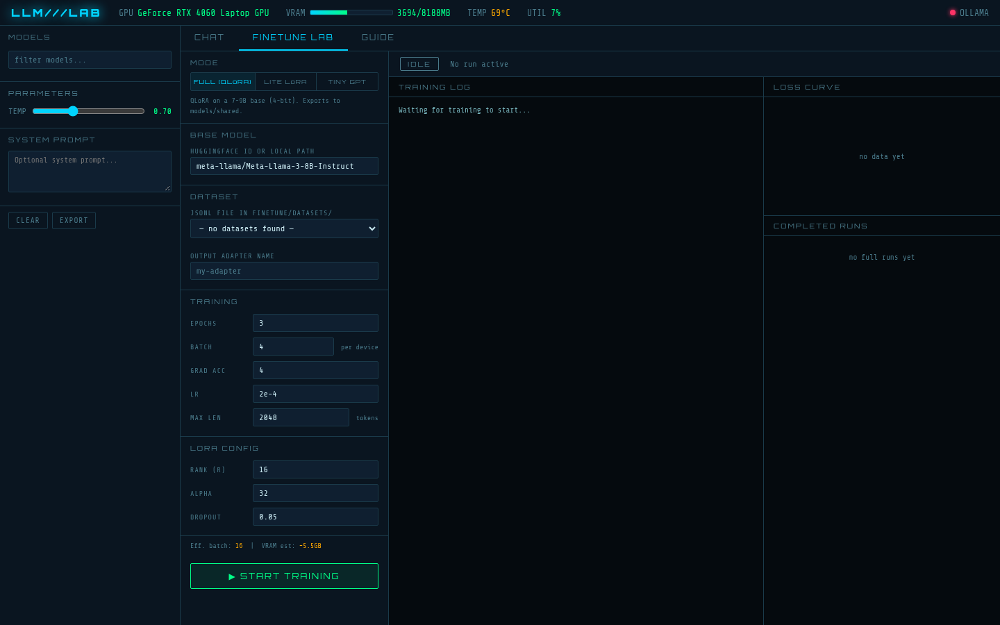
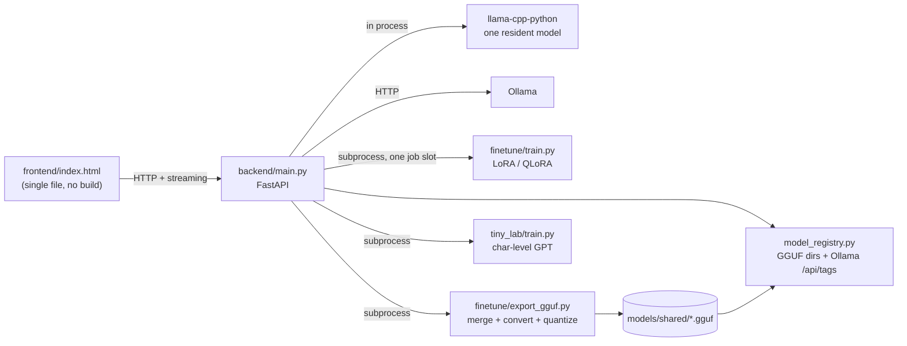

# LLM Lab

A local workbench for running and fine-tuning language models on a single consumer GPU. One FastAPI process serves chat over local GGUF models (llama.cpp) and Ollama, runs LoRA and QLoRA fine-tunes as supervised background jobs, exports the result to GGUF, and trains a small character-level GPT from scratch. It exists to make the full loop (pick a base model, train an adapter, export it, chat with it) work on an 8 GB laptop GPU without the inference server and the trainer fighting over VRAM.



## Architecture



- **Model registry** (`backend/model_registry.py`): rebuilt on demand by scanning GGUF directories and asking Ollama for its installed models, so new files and pulls appear without a restart. Known filenames are enriched with prompt format, context length and GPU layer counts; absolute paths are stripped before anything is sent to a client.
- **Single resident model**: at most one llama.cpp model is loaded at a time. Swapping frees the old one and clears the CUDA cache first.
- **Job slot**: fine-tunes, exports and tiny-GPT runs share one slot. While a job holds it, `/api/chat`, `/api/models/load` and `/api/tiny/sample` return `503 training job running`, so inference can never push a training run out of VRAM. The slot is claimed under the same lock that guards model swaps, so a swap and a job start cannot interleave.
- **Progress protocol**: training scripts print `@@METRIC {json}` lines (step, loss, val_loss, lr). The backend pumps the subprocess's stdout, keeps the log, and parses those lines into the loss curve the UI draws.

## Stack

- Python 3.10, FastAPI, Uvicorn, httpx, Pydantic
- llama-cpp-python (CUDA build) and Ollama for inference
- PyTorch, Transformers, PEFT, TRL, bitsandbytes, Datasets for training
- llama.cpp's `convert_hf_to_gguf.py` and `llama-quantize` for export
- A single-file HTML/CSS/JS frontend with no build step

## Technically notable parts

**Two fine-tuning profiles** (`finetune/train.py`). Settings resolve as profile defaults, then an optional `--config` JSON, then explicit CLI flags.

| | `full` | `lite` |
|---|---|---|
| Base | 7 to 9B, 4-bit (QLoRA) | small model in bf16 |
| LoRA rank / alpha | 16 / 32 | 8 / 16 |
| Target modules | all attention + MLP projections | `q_proj`, `v_proj` |
| Max length | 2048 | 512 |
| Optimizer | `paged_adamw_8bit` | `adamw_torch` |
| Validation split | none | 10%, eval every 20 steps |
| Export | Q4_K_M into `models/shared/` | Q8_0 into `models/lite/` (lab-only) |

Lite exports are tagged with a `lab` scope and hidden from `/api/models` unless the caller passes `?include_lab=1`, so experiments never show up in other apps that read the same registry.

**Pad token handling.** If a tokenizer's pad token would equal its end-of-turn token, the collator masks it out of the loss and the model never learns to stop. `train.py` detects this and picks a distinct pad token from a candidate list instead.

**GGUF export** (`finetune/export_gguf.py`). Merges the adapter into the base model, converts with llama.cpp, quantizes, and falls back to an F16 GGUF if `llama-quantize` is missing or fails.

**Tiny GPT** (`tiny_lab/`). A from-scratch, character-level, decoder-only transformer: pre-LayerNorm blocks, causal-masked attention, 4x GELU MLP, learned positional embeddings and a weight-tied output head. Trained and sampled through the same job slot as the fine-tunes.

**Browser access from an HTTPS page.** A companion habit tracker served over HTTPS calls this backend on `localhost`. Chrome treats that as a public-to-private request and sends a Private Network Access preflight, which Starlette's CORS middleware rejects. A small middleware answers those preflights for allowed origins only. Extra origins come from `LLM_LAB_ALLOWED_ORIGINS`.

**Coach helpers** (`backend/coach.py`). Turn chat transcripts into `{"instruction", "output"}` training pairs (keeping structured ` ```entry ` blocks so a model learns to emit them) and build the coach system prompt for callers that send structured context.

## Running locally

Requirements: Linux, an NVIDIA GPU with a recent driver and CUDA, Python 3.10. Developed on an RTX 4060 Laptop GPU (8 GB).

```bash
git clone https://github.com/elijahsylar/llm-lab.git
cd llm-lab
python3 -m venv .venv
. .venv/bin/activate
CMAKE_ARGS="-DGGML_CUDA=on" pip install llama-cpp-python==0.3.23
pip install -r requirements.txt
cp .env.example .env          # optional settings; all have defaults
./start.sh                    # backend on :8000, then opens frontend/index.html
```

- Put GGUF files in `models/` or `models/shared/` (or point `LLM_LAB_SHARED_MODELS_DIR` at an existing folder). Ollama models appear automatically if Ollama is running.
- Fine-tuning datasets are JSONL files with `instruction` and `output` fields in `finetune/datasets/`.
- GGUF export needs a llama.cpp checkout; set `LLAMA_CPP_DIR`.
- Run the backend directly with `uvicorn backend.main:app --port 8000`. Do not use `--reload`: the job slot and the resident model live in process memory.

### Tests

```bash
python -m unittest discover -s tests -t . -v
```

11 tests cover the registry scan (filename slugs, companion-file exclusion, lab scope and preset matching for lite exports, stable keys on collisions, path stripping) and the transcript-to-training-pair conversion. They need no GPU, models or Ollama.

## Project status

A personal tool, in regular use on one machine. It assumes a single local user and has no authentication; do not expose port 8000 beyond localhost.

## License

MIT. See [LICENSE](LICENSE).
